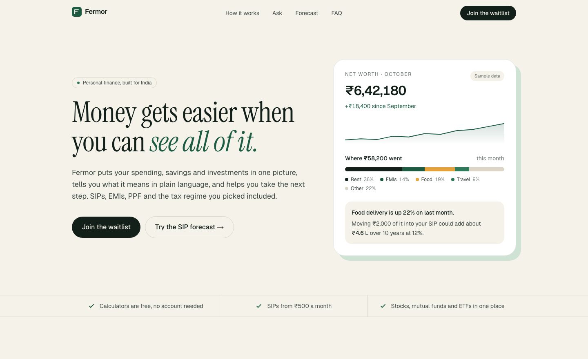
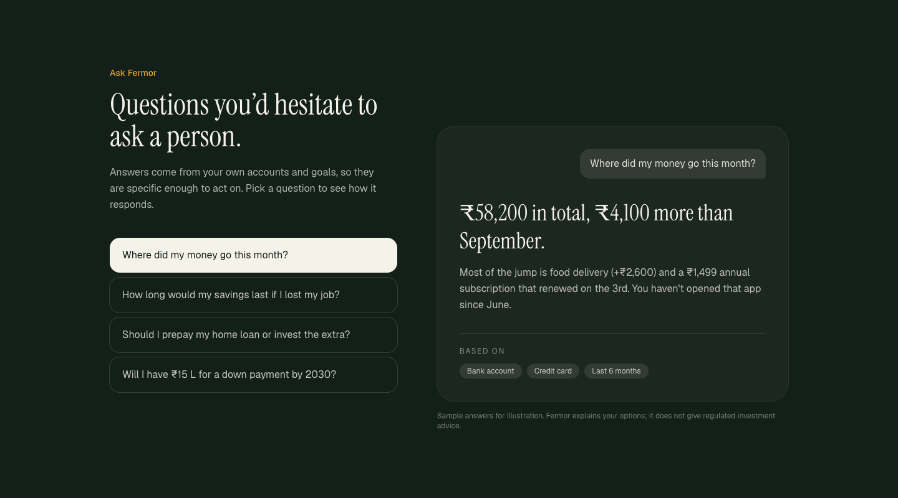
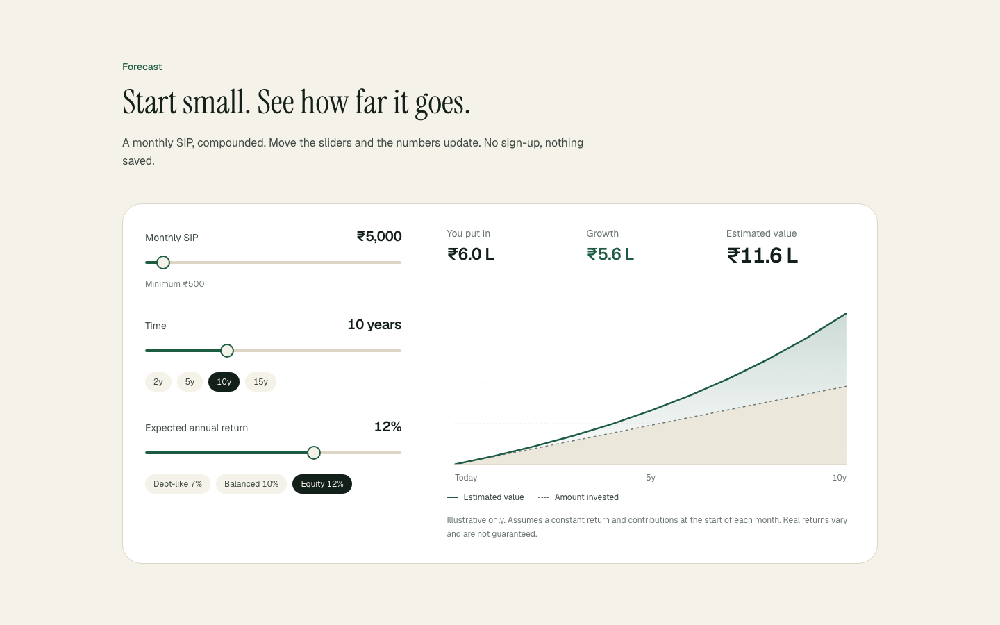
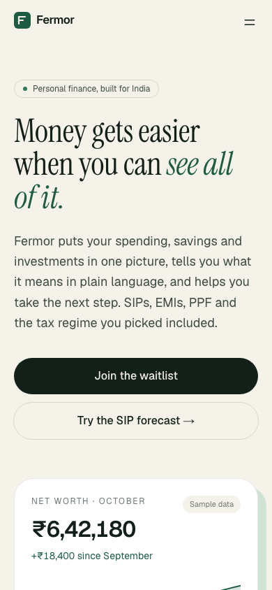
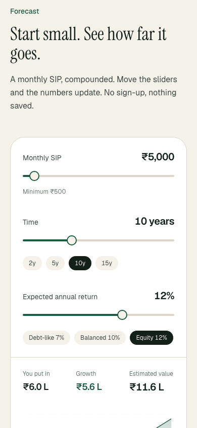

# Fermor homepage

A homepage concept for [Fermor](https://fermor.in), a personal finance platform for India.

**Live:** https://fermor-homepage-delta.vercel.app

## Screenshots







<p>
  
  &nbsp;
  
</p>

## Run it

```bash
npm install
npm run dev      # http://localhost:3000
npm run build && npm start   # production
npm test         # unit + component tests
```

Requires Node 22.12+. Stack: Next.js 16 (App Router), React 19, TypeScript, Tailwind CSS v4. No UI or chart libraries.

## Testing

Vitest + React Testing Library (jsdom), 42 tests across 6 files. CI (`.github/workflows/ci.yml`) runs lint, typecheck, tests and a production build on every push and PR.

| File | What it covers |
| --- | --- |
| `lib/money.test.ts` | INR grouping, lakh/crore thresholds, SIP maths checked against the annuity-due formula, 0% edge case |
| `api/waitlist/route.test.ts` | 201 / 400 / 422 paths: bad JSON, `null` body, non-string and over-length emails, unknown interest; email is never logged |
| `Forecast.test.tsx` | Sliders and presets recompute totals; `aria-pressed`, `aria-valuetext`, chart label |
| `AskDemo.test.tsx` | Tab switching, roving `tabIndex`, arrow-key navigation with wrap-around |
| `Waitlist.test.tsx` | Client validation blocks the request, payload is trimmed, server and network errors surface |
| `Nav.test.tsx` | Mobile menu toggle, scroll lock, Escape to close |

Tests query by role and accessible name rather than class names, so they double as accessibility checks and survive styling changes. To check the suite actually catches regressions, I removed the start-of-month factor from the SIP formula: 3 tests failed.

Not covered: visual regression and real-browser E2E. Playwright against the deployed URL would be the next step.

## The idea

Fermor's own line is "understand, act and grow financially". I built the page around that order, because it is also the order people come to money problems in: first they want to know where they stand, then what to do, then where it leads.

**Who it's for:** salaried people in India, roughly 22 to 35, who earn decently, have an EMI or a SIP they set up once and forgot, and feel slightly behind. They don't need a trading terminal. They need someone to explain their own numbers.

**What the page has to do:** make that person think "this is about *my* money" within the first screen, then earn trust before asking for an email.

## Page structure

| Section | Job |
| --- | --- |
| Hero | One sentence on the value, plus a sample monthly snapshot so the product is visible right away. The insight at the bottom of the card ("food delivery is up 22%…") shows the product's tone. |
| Fact strip | Three concrete facts taken from Fermor's current site (free calculators, ₹500 SIPs, stocks/MFs/ETFs). I left out fake logos, user counts and testimonials, since a pre-launch fintech that invents social proof loses trust. |
| How it works | Understand → Act → Grow, each with a small UI piece instead of an icon. |
| Ask Fermor | Interactive. Four real-feeling questions with specific answers. Every answer lists the data it is "based on". That is the differentiator, so it gets the dark, high-contrast section. |
| Forecast | Working SIP calculator: sliders, presets matching Fermor's 2/5/10/15-year horizons, a live SVG chart with hover/touch read-out. This is the "act now" moment. |
| Honest about what it is | Not a SEBI-registered adviser, assumptions shown, calculators free. In Indian fintech, being clear about regulation builds trust, so I gave it a section of its own instead of leaving it in the footer. |
| FAQ | Native `<details>`: accessible, no JS. |
| Waitlist | Optional "what would you use it for first" chips (useful product signal for Fermor) and an email field, posted to a real API route. |

## Decisions worth calling out

- **Visual direction.** Warm paper background, deep forest green, one saffron accent. I avoided the default fintech look (purple gradients, glass cards, neon charts) because the brand promise is *calm and clear*, and an editorial serif (Instrument Serif) with a neutral sans (Geist) reads as considered rather than hyped.
- **Indian formatting everywhere.** `Intl.NumberFormat("en-IN")` for ₹6,42,180 grouping, lakh/crore short forms in charts, tabular numerals so figures line up.
- **Consistent sample data.** The hero snapshot, the "Ask" answers and the ₹4.6 L figure all describe the same fictional user, and the maths checks out (`src/lib/money.ts`). Inconsistent sample numbers are an easy tell of a mock-up.
- **SIP maths.** Monthly compounding, contributions at the start of the month (annuity-due), the convention used by most Indian AMC calculators. Assumptions are printed under the chart.
- **No chart library.** The chart is ~80 lines of SVG. It keeps the bundle small, and every pixel is controllable. Axis labels are HTML so they stay readable when the SVG scales down on phones.
- **Server vs client.** Only the four interactive pieces (`Nav`, `AskDemo`, `Forecast`, `Waitlist`) are client components; the rest render on the server and ship no JS.
- **Waitlist API.** `POST /api/waitlist` validates at the boundary (JSON, email shape/length, interest allow-list) and returns 400/422/201. Persistence is deliberately out of scope; the handler is where a DB insert or Resend/Loops call would go.
- **Accessibility.** Skip link, semantic landmarks, WAI-ARIA tabs with arrow-key support on "Ask", `aria-pressed` toggles, labelled range inputs with `aria-valuetext` in rupees, visible focus rings, `prefers-reduced-motion` respected.

## What I'd do next

- Persist waitlist sign-ups and add rate limiting on the route.
- Real product screenshots in place of the illustrative cards.
- Hindi version of the hero and FAQ.
- Lighthouse and real-device pass on low-end Android, which is a large share of Indian traffic.

## Structure

```
src/
  app/
    layout.tsx         fonts, metadata
    page.tsx           section order
    globals.css        design tokens (Tailwind v4 @theme), range input styles
    api/waitlist/      POST handler with validation
  components/          one file per section
  lib/money.ts         INR formatting + SIP projection
```
